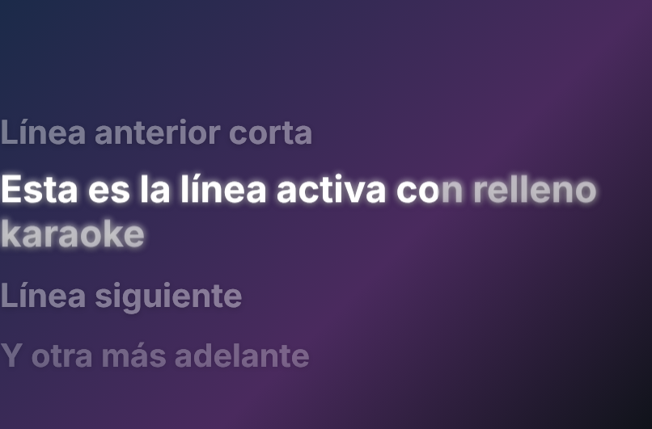

# Cantani

**Letras sincronizadas flotando sobre tu pantalla en Windows.**

Cantani muestra la letra de la canción que estás escuchando, encima de cualquier ventana de tu escritorio. Detecta automáticamente lo que suena en **Spotify** y en **YouTube / YouTube Music**, busca la letra sincronizada y resalta cada línea al ritmo de la música, con relleno estilo **karaoke**.



*Imagen de ejemplo con texto de prueba.*

## Características
- Detecta Spotify (app de escritorio) y YouTube / YouTube Music en Chrome, Edge o Brave.
- Letra sincronizada con relleno karaoke palabra a palabra (estimado).
- Posición a tu gusto: izquierda, centro o derecha; arriba, medio o abajo.
- Tamaño, fuente, colores, brillo y animaciones configurables, con **Modo ligero** para equipos justos.
- La ventana deja pasar los clics: no estorba a lo que estés haciendo.
- Ajuste de sincronía por canción, que se recuerda.
- Se queda en la bandeja del sistema, junto al reloj.

## Instalación (usuarios)
1. Ve a **[Releases](../../releases)** y descarga `Cantani-Windows.zip`.
2. Haz clic derecho → **Extraer todo**. No lo abras desde dentro del zip.
3. Abre `Cantani.exe`.
4. Si Windows muestra *"Windows protegió tu PC"*: **Más información → Ejecutar de todas formas**. Aparece porque la aplicación no está firmada digitalmente.
5. Pon una canción. La letra aparece sola.

No necesitas instalar nada más. Hace falta conexión a internet para buscar las letras.

**Requisitos:** Windows 10 u 11 (versión estable; las compilaciones Insider pueden fallar) y Spotify de escritorio o YouTube en el navegador.

## Uso
El icono de Cantani está junto al reloj (puede estar bajo la flecha `^`). Con clic abres los **Ajustes**. Para cerrarlo del todo: icono → **Salir**.

| Atajo | Qué hace |
|---|---|
| `Ctrl+Alt+L` | Muestra u oculta las letras |
| `Ctrl+Alt+→` / `←` | Adelanta o atrasa la letra 0,25 s (solo esa canción) |
| `Ctrl+Alt+Shift+→` / `←` | Lo mismo, de 2 s en 2 s |
| `Ctrl+Alt+RePág` | Alinea la primera línea cantada con lo que oyes |
| `Ctrl+Alt+↓` | Restablece el ajuste de esa canción |

Si no tienes la tecla RePág, mantén pulsada `Fn`. El ajuste de cada canción se guarda.

### Si la letra va desfasada
1. Pulsa `Ctrl+Alt+RePág` justo cuando oigas cantar la **primera línea** de la letra.
2. Para retoques, usa **−1 s / +1 s** en Ajustes o `Ctrl+Alt+←` / `→`.

### Si no detecta la música
- Ajustes arriba dice **"Esperando música…"**: Windows no ve ningún reproductor. Cierra y abre Spotify, no lo ejecutes como administrador, y prueba un video de YouTube para comparar. Si usas Spotify de la tienda de Microsoft, suele funcionar mejor.
- Ajustes → **Diagnóstico → Copiar informe** copia datos útiles (versión de Windows, reproductores que ve el sistema) para que los pegues al abrir un *issue*.

## Compilar desde el código
Necesitas [Node.js](https://nodejs.org) LTS.

```bash
npm install
npm start        # ejecuta la app
npm test         # pruebas
npm run dist     # genera el instalable (electron-builder)
```

Más detalles de cómo funciona la sincronización en [`docs/NOTAS-TECNICAS.md`](docs/NOTAS-TECNICAS.md).

## Cómo funciona
- Lee el reproductor activo del sistema de medios de Windows (SMTC) mediante un proceso de PowerShell: título, artista, posición y duración.
- Busca la letra sincronizada en **YouTube Music** (servicio no oficial) y en **[LRCLIB](https://lrclib.net)**, una base de letras abierta. Elige la versión cuya duración coincide con la canción.
- Dibuja la letra en una ventana transparente, siempre encima y sin foco.

## Modo inteligente

Viene activado. Cuando empieza una canción, Cantani escucha el audio del sistema para medir cuándo canta
la voz y corrige la sincronía de esa canción sin que tengas que tocar nada. Lo que aprende se guarda, así
que la próxima vez va bien desde el principio.

- El audio se analiza **en tu ordenador** y no se guarda ni se envía a ningún sitio: solo se mide el nivel
  de sonido, nunca se graba.
- Si no está seguro, no cambia nada. Y si cambia algo que luego no se confirma, lo deshace solo.
- Nunca pisa un ajuste hecho a mano con los atajos.
- Se puede apagar en Ajustes, o con `Ctrl + Alt + I`.

## Limitaciones
- Las letras vienen de terceros; algunas canciones (remixes, versiones raras) pueden no tener letra o tenerla desfasada.
- YouTube Music se consulta con un servicio **no oficial** que podría cambiar o dejar de funcionar en cualquier momento. LRCLIB se usa como respaldo.
- El relleno karaoke es una estimación por sílabas y pausas, no tiempos reales por palabra.
- Solo Windows.

## Aviso legal
Cantani es un proyecto independiente y **no está afiliado, respaldado ni patrocinado por Spotify, Google, YouTube ni Microsoft**. Todos los nombres y marcas pertenecen a sus dueños. Este repositorio **no contiene letras de canciones**: se descargan al momento para uso personal y solo se guardan en tu equipo. Usa el programa respetando los términos de los servicios que consultas.

## Licencia
[MIT](LICENSE)
